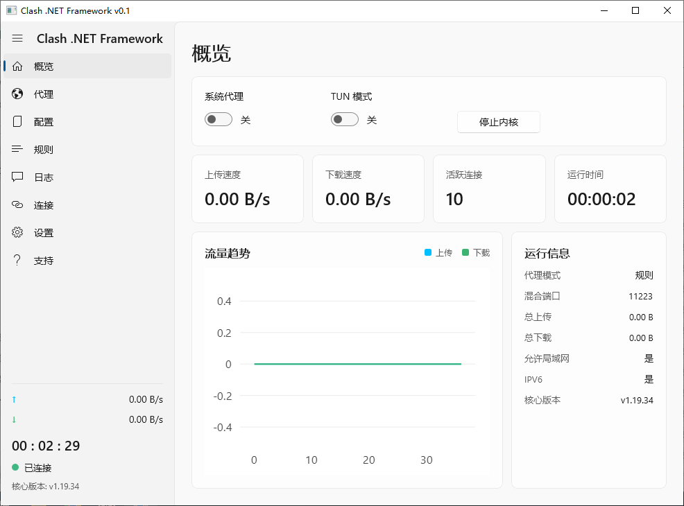
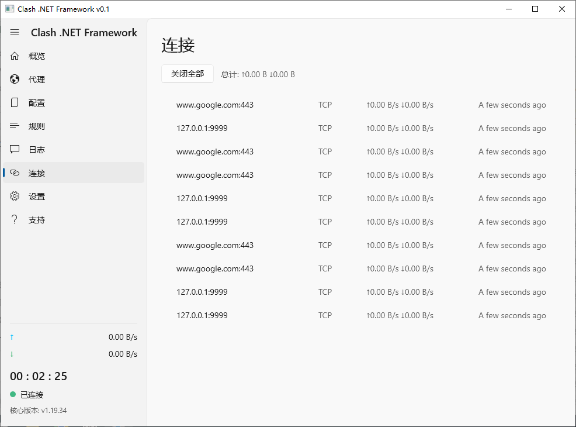
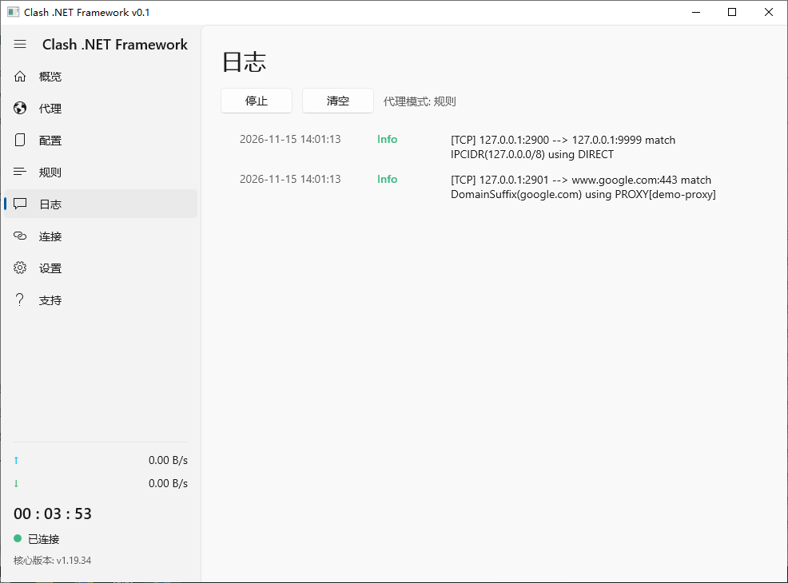
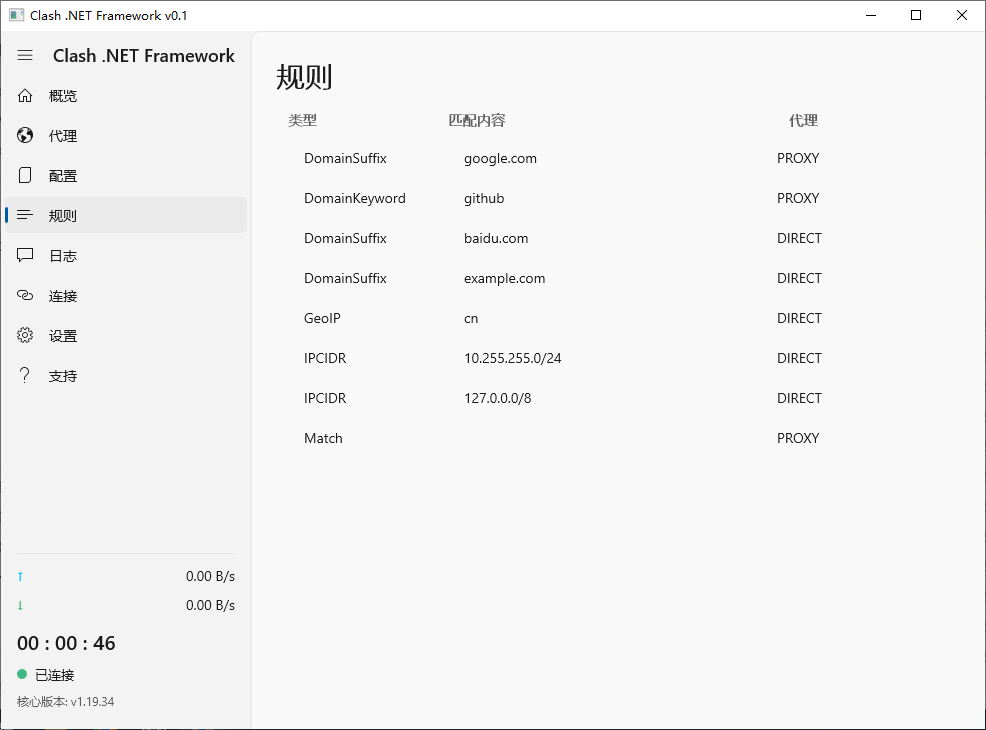
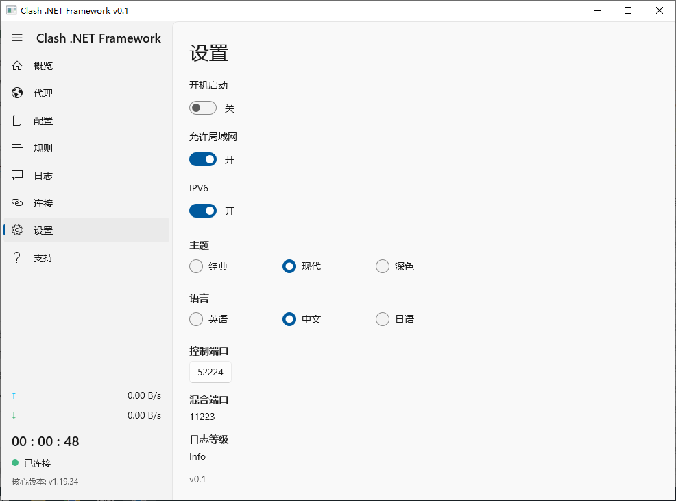

# ClashWinUI

基于 **WinUI 3 + .NET 10** 重写的 Windows 代理客户端，由 [ClashDotNetFramework](https://github.com/sqzxcv/ClashDotNetFramework-src)（WPF）迁移而来：复用其核心逻辑，UI 全部重写，内核替换为 **mihomo（Clash.Meta）**，进程代理（NetFilter）替换为 **mihomo 内置 TUN**。

## 功能

- **mihomo 内核**：随应用启动/停止，RESTful API 控制，配置热重载
- **仪表盘**：系统代理开关、TUN 开关、内核启停按钮；上传/下载速度、活跃连接、运行时长 KPI；流量趋势图；运行信息（代理模式、混合端口、累计流量、局域网/IPv6、内核版本）
- **页面**：概览 / 代理 / 配置 / 规则 / 日志 / 连接 / 设置 / 支持
- **实时数据**：流量、日志、连接经 WebSocket 推送，断线自动重连
- **TUN 模式**：mihomo 内置 TUN（mixed 栈），自动写入 tun/dns 配置段，需管理员权限
- **系统代理**：一键全局代理/直连切换，托盘菜单同步
- **托盘**：最小化到托盘、速度显示、系统代理/TUN 快捷开关
- **多语言**：中文（默认）/ English / 日本語；经典/现代/深色主题
- **其他**：订阅配置管理、MMDB 更新、UWP 环回豁免、开机启动、防火墙辅助进程

## 截图

| 概览 | 连接 |
| --- | --- |
|  |  |

| 日志 | 规则 |
| --- | --- |
|  |  |



## 运行要求

- Windows 10 1809 (17763) 及以上，x64
- 绿色免安装：解压后直接运行 `ClashDotNetFramework.exe`
- **self-contained 版**：无需安装任何运行时
- **framework-dependent 版**：需安装 [.NET 10 Desktop Runtime](https://dotnet.microsoft.com/download/dotnet/10.0)
- TUN 模式需以管理员身份运行（应用会自动请求提权启动内核）
- 配置目录：`%USERPROFILE%\.config\clash`（首次运行自动创建，内置 Country.mmdb 自动释放）

## 构建

需要 [.NET 10 SDK](https://dotnet.microsoft.com/download/dotnet/10.0)，仅支持 `win-x64`。

内核与地理数据库**不入库**，编译前放入 `native/` 目录（CI 会自动下载）：

| 文件 | 来源 |
| --- | --- |
| `mihomo.exe` | [MetaCubeX/mihomo releases](https://github.com/MetaCubeX/mihomo/releases)（windows-amd64 zip 内 exe） |
| `wintun.dll` | 同上 zip 内附带（TUN 必需） |
| `Country.mmdb` | [MetaCubeX/meta-rules-dat](https://github.com/MetaCubeX/meta-rules-dat/releases/tag/latest) |
| `EnableLoopback.exe` | 已入库（UWP 环回豁免工具） |

```bash
# 调试运行
dotnet build src/ClashWinUI/ClashWinUI.csproj -c Debug

# 发布：不依赖运行时（self-contained）
dotnet publish src/ClashWinUI/ClashWinUI.csproj -c Release -r win-x64 -p:SelfContained=true -o publish/sc

# 发布：依赖运行时（framework-dependent）
dotnet publish src/ClashWinUI/ClashWinUI.csproj -c Release -r win-x64 -p:SelfContained=false -o publish/fd
```

发布产物 `bin/` 子目录自动包含内核、wintun、MMDB 与 FireWallHelper；XBF/PRI 资源由 csproj 的发布目标补齐（非打包模式必需）。

## CI / 发布

GitHub Actions（`.github/workflows/build.yml`）在 push / PR / 手动触发时：

1. 下载 mihomo 内核（版本由 `MIHOMO_VERSION` 控制）与 Country.mmdb 引入编译
2. 矩阵发布 **self-contained** 与 **framework-dependent** 两个版本（其余发布开关保持 true）
3. 上传 `ClashWinUI-self-contained-win-x64` / `ClashWinUI-framework-dependent-win-x64` 产物

打 `v*` tag 触发时，tag 号（如 `v0.1` → `0.1`）会注入为应用版本，显示在窗口标题与设置页。版本自 `v0.1` 起步。

## 目录结构

```
src/ClashWinUI        WinUI 3 主程序（页面/控制器/工具/模型）
src/FireWallHelper    防火墙规则辅助进程（提权操作）
native/               内核与地理数据库（CI 引入，不入库）
docs/screenshots      界面截图
.github/workflows     CI 双版本发布
```

## 致谢

- [ClashDotNetFramework](https://github.com/sqzxcv/ClashDotNetFramework-src)（Coel Wu）——原始 WPF 项目与核心逻辑
- [mihomo](https://github.com/MetaCubeX/mihomo) ——内核
- [MetaCubeX/meta-rules-dat](https://github.com/MetaCubeX/meta-rules-dat) ——GeoIP 数据库